# chibi32

427 pixel-art sprites for fantasy RPGs, all in one 32×32 chibi style: characters, monsters, animals, items, props, nature, buildings, effects, UI icons and seamless tiles.

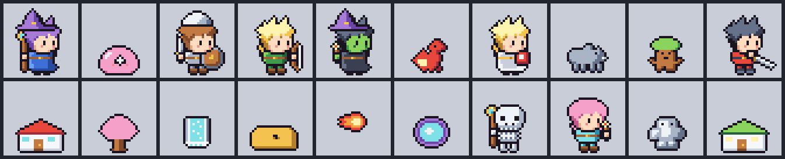

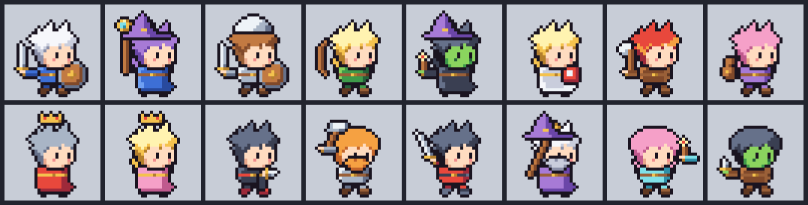

Every sprite is stored as plain text (a grid of palette keys), so you can read, diff and edit pixels in any text editor. A build script turns the text into PNGs, sprite sheets, JSON frame data and GIFs.

**License: [MIT](LICENSE)**, for both code and art. Use the sprites in free or commercial projects; keep the license notice with copies. See [LICENSING.md](LICENSING.md).

## Gallery

| Category | Count | Animated |
|---|---:|---|
| [Characters](#characters) | 78 | all: 4-frame walk |
| [Monsters](#monsters) | 56 | slimes, bats: 2 to 4 frames |
| [Animals](#animals) | 10 | |
| [Items and equipment](#items-and-equipment) | 48 | coin spin |
| [Props and furniture](#props-and-furniture) | 110 | torch, campfire, portal, fireplace |
| [Nature](#nature) | 70 | waterfall, geyser |
| [Buildings](#buildings) | 8 | |
| [Effects](#effects) | 10 | most: 2-frame loop |
| [UI and status icons](#ui-and-status-icons) | 11 | |
| [Tiles](#tiles) | 26 | seamless 32×32 |

The full list with every id, title and description is in [docs/catalog.md](docs/catalog.md).

### Characters

78 characters share one walk cycle. Each holds its weapon in a small fist that touches the body, in one of five poses: rest (upright at the hip), raise (fist at the chin, weapon up behind the head), thrust (level, pointing ahead), guard (upright in front) and low (tipped toward the ground).

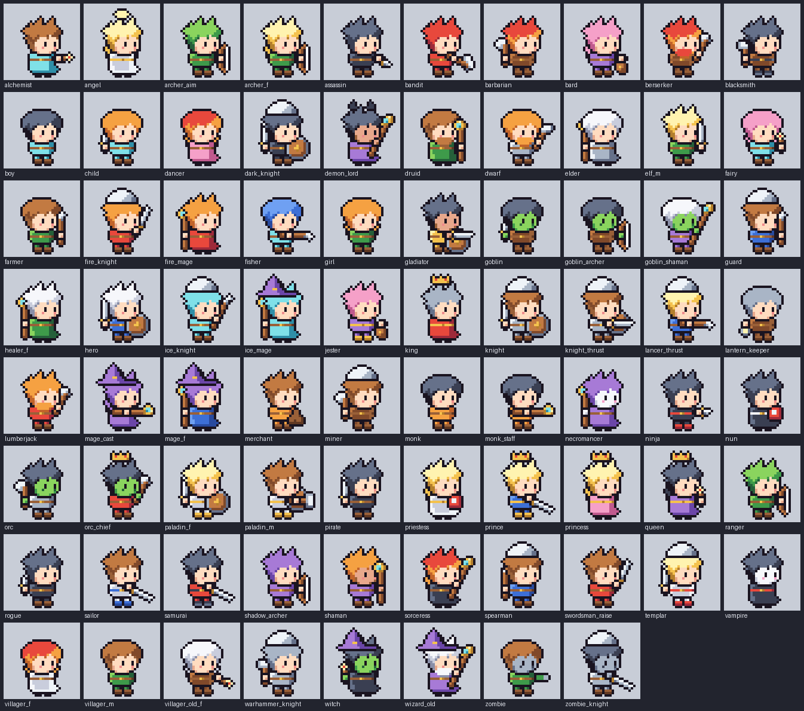

### Monsters

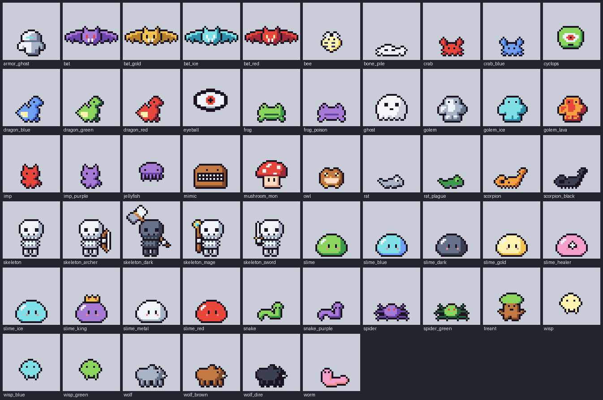

### Animals

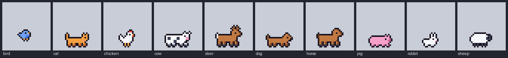

### Items and equipment

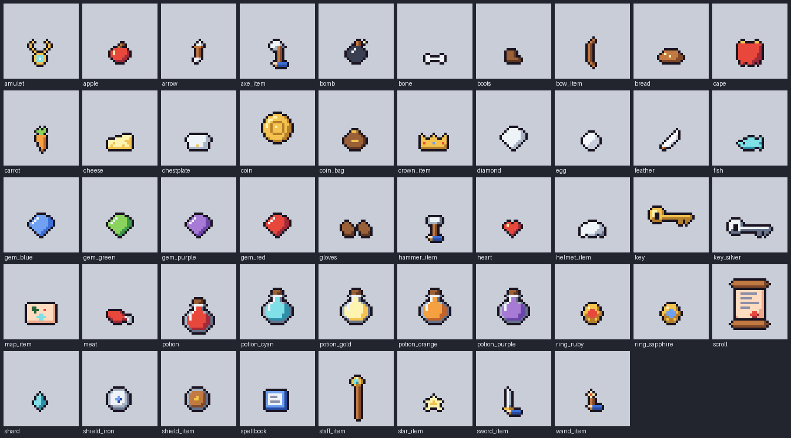

### Props and furniture

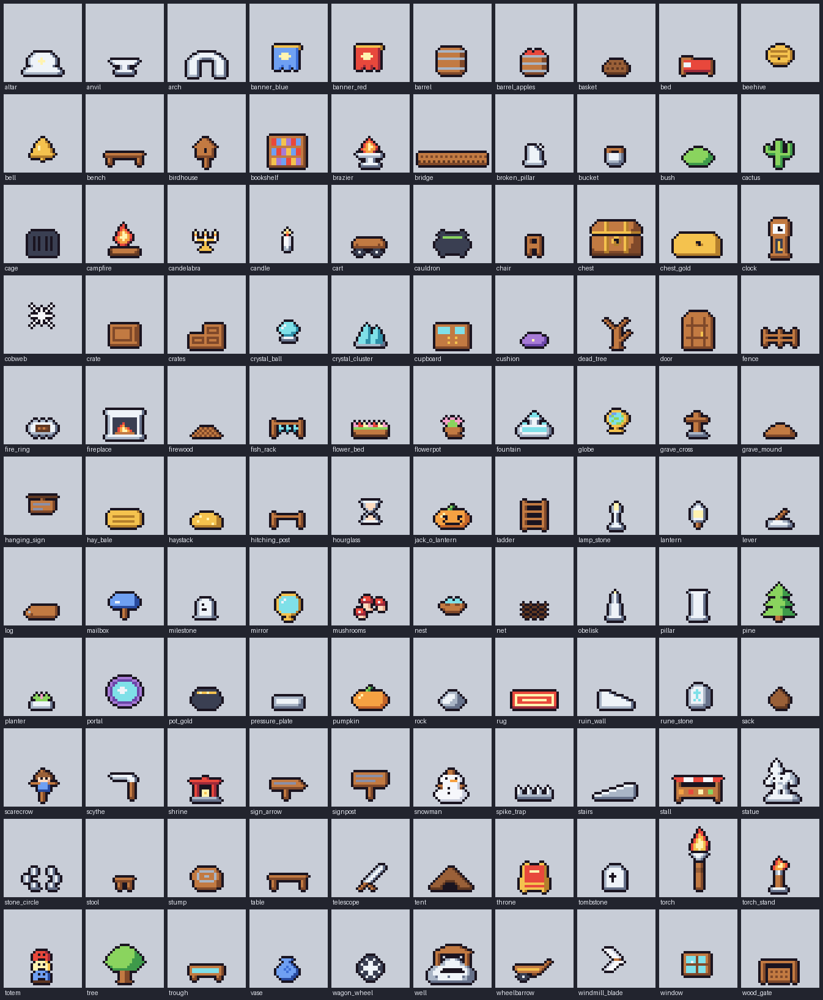

### Nature

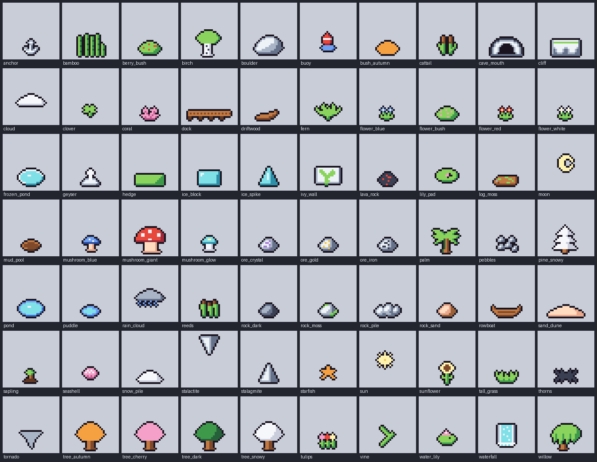

### Buildings

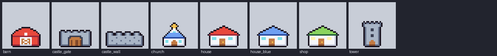

### Effects

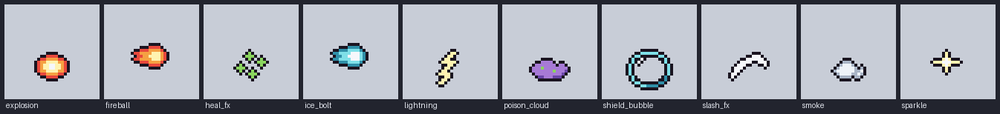

### UI and status icons

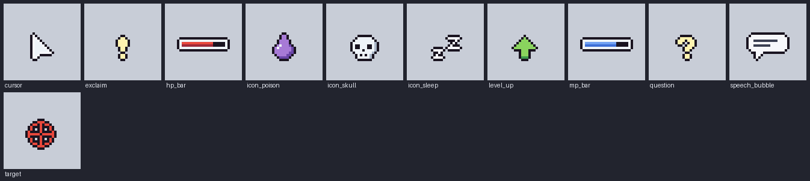

### Tiles

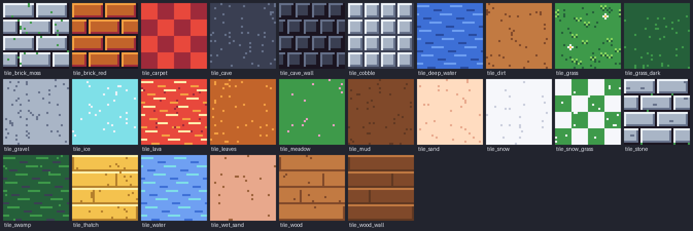

## Using the sprites

Take the files you need from `dist/<id>/`. For example, `dist/mage_f/`:

| File | Contents |
|---|---|
| `mage_f_base.png` | Standing frame, 32×32 |
| `mage_f_walk_0.png` … `_walk_3.png` | Walk frames, 32×32 |
| `mage_f_walk_sheet.png` | Walk sprite sheet, one row, 128×32 |
| `mage_f_walk.json` | Frame order, sheet rectangles, durations (ms), anchor, loop flag |
| `mage_f_walk.gif`, `mage_f_walk_x8.gif` | GIF at 1× and 8× |

Static assets have only `<id>_base.png`, plus extra stills where they exist, such as `potion_mana.png` or `chest_open.png`.

- Scale by whole numbers with nearest-neighbor filtering, or the pixels blur.
- `anchor` in the JSON is the ground point. For characters it is (16, 29), between the feet.
- All sprites use one 34-color palette, so they sit together in one scene.

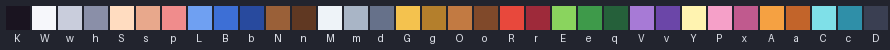

### Browse locally

[index.html](index.html) is a static viewer: pick an asset, zoom it, step through frames and download its files.

```bash
python -m http.server 8000
```

Then open `http://localhost:8000`.

## Editing and adding sprites

Requires Python 3.10 or later and Pillow.

```bash
pip install -r requirements.txt
```

```bash
python tools/build.py
```

```bash
python tools/check.py
```

```bash
python -m unittest discover tests
```

`build.py` writes `dist/`. `check.py` verifies sizes, palette, transparency, sheet rectangles, GIF frames and the ground line, and prints `PASS`. The tests break the output on purpose to prove the checker catches it. None of these judge how the art looks.

### Where the pixels live

| Path | Role |
|---|---|
| `assets/<id>/<id>.sprite` | Pixel grids, frames and animations as text. Generated for most assets; hand-typed source for 9 of them (`hero`, `slime`, `bat`, `coin`, `potion`, `key`, `scroll`, `chest`, `torch`); `tile_grass` and `tile_stone` come from their own `recipe.py` |
| `assets/<id>/recipe.py` | Draws the `.sprite`. For templated assets it is one line, `make("<id>")` |
| `tools/kit32.py` | Shared grids (heads, bodies, legs, weapons), recoloring, character and item templates, weapon poses and grips |
| `tools/kit32_more.py`, `kit32_nature.py`, `kit32_gaps.py` | The later groups of asset specs |
| `styles/chibi32/palette.txt` | The 34 allowed colors, one letter each |
| `styles/chibi32/rules.md` | Proportions, outline, lighting and animation rules (Korean) |
| `assets/<id>/credits.json` | Authors, tools, AI use, references, license |

A `.sprite` file looks like this:

```
[part body]
.LLBBBBBb.
LLBBBBBBbb
...

[frame base]
legs_stand 12 26
body 11 20

[anim walk]
walk_0 150
```

`.` is transparent; every other character is a palette key. The build draws a 1px dark outline around each part automatically. Do not edit a `.sprite` that has a `recipe.py` next to it: the next build overwrites it, and `check.py` reports the edit. Change the spec in `tools/kit32*.py` instead.

To add a templated asset, add a `spec(...)` line in one of the `kit32*.py` files, then run:

```bash
python tools/gen_rpg100.py
```

```bash
python tools/build.py
```

```bash
python tools/preview.py
```

`gen_rpg100.py` creates the `assets/<id>/` folder and `credits.json`. `preview.py` redraws the gallery images and `docs/catalog.md`.

## How this was made

The pixels were written as text by Claude (Anthropic's language model) in Claude Code, rendered, looked at and revised. No image-generation model was used. A human directed the style and the asset list. Each asset's `credits.json` records this.

Known limits:

- At 32×32 the characters have no visible forearms: a 2×2 fist on the body holds the weapon.
- Some props read weakly at this size, for example the stone circle, vine, tornado and gloves.
- Characters have only a walk animation, facing right. Mirror the image for left; the held weapon then switches hands.
- Art quality was judged by eye, not by the automated checks.

## Contributing

Issues and pull requests are welcome. Run `build.py`, `check.py` and the tests before opening a pull request, and commit the regenerated `dist/` and `preview/`.
