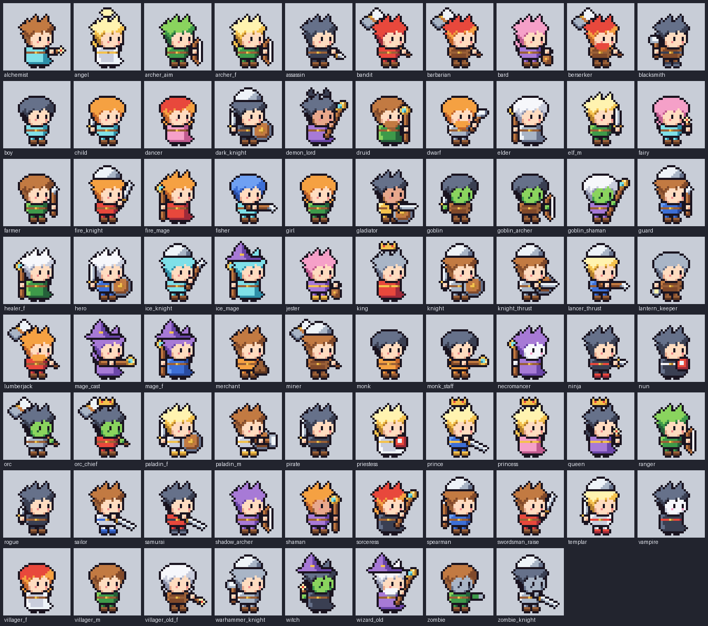
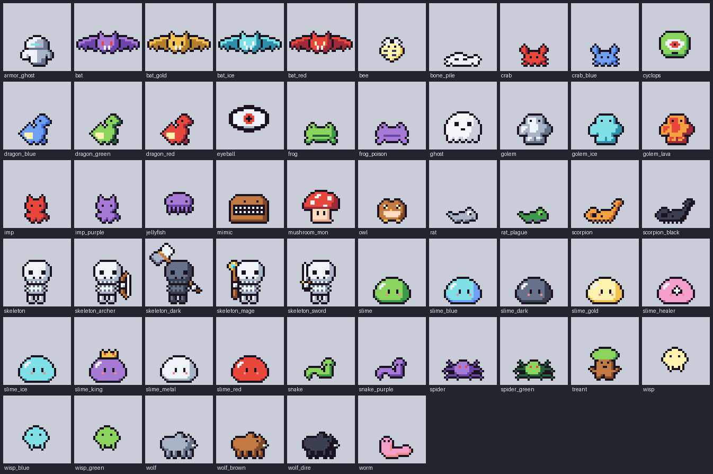
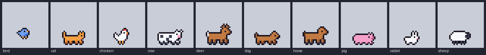
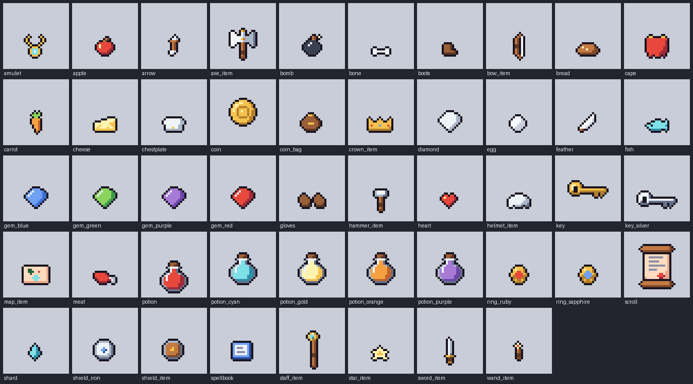
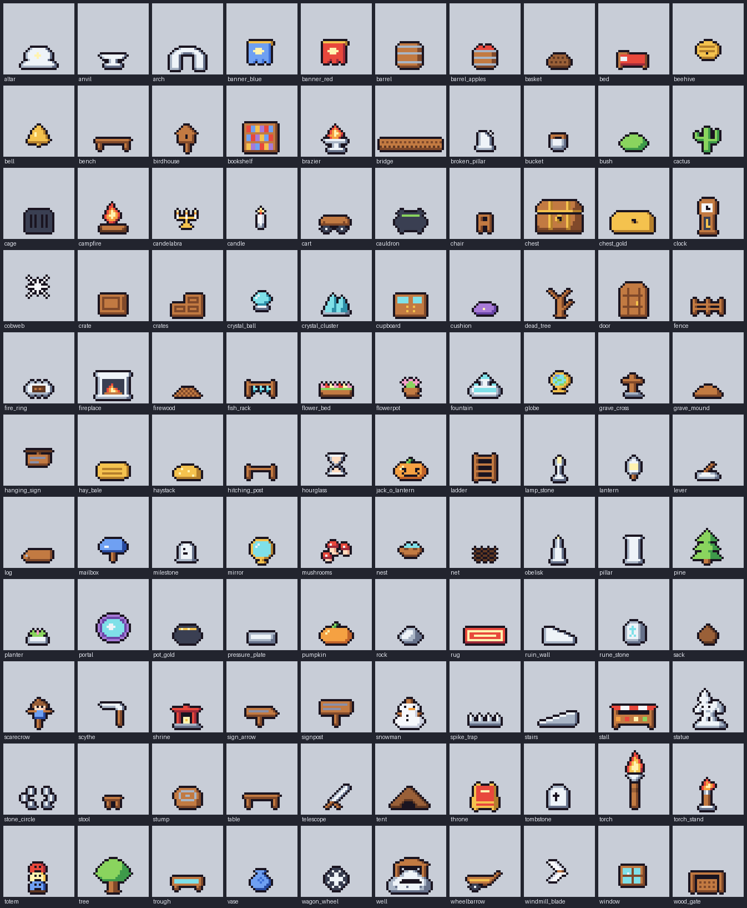
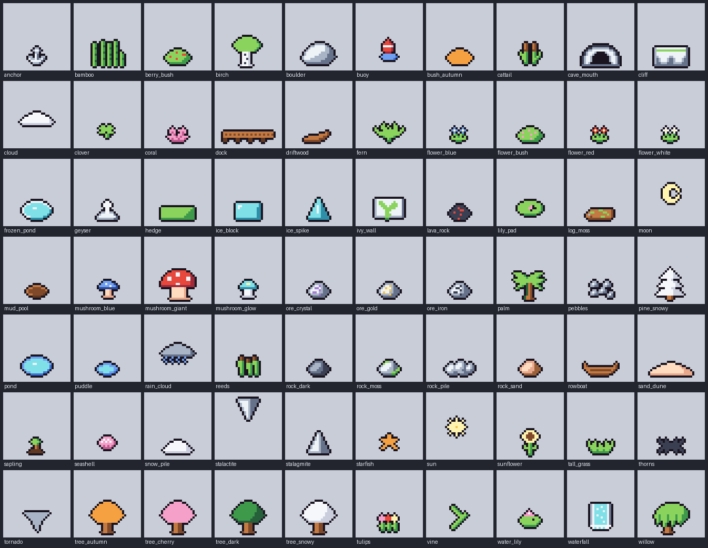
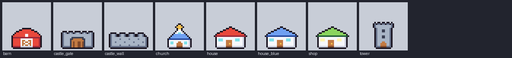
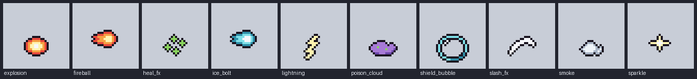
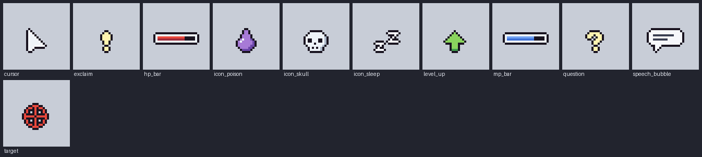
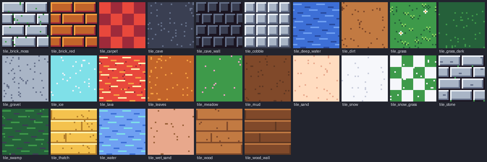

# Asset catalog

427 assets. Descriptions are in Korean, the language the set was briefed in; titles are in English. Files for each id are in `dist/<id>/`.

## Characters (78)

| id | title | description |
|---|---|---|
| `alchemist` | Alchemist | 연금술사. 하늘색 로브, 마법봉을 앞으로. |
| `angel` | Angel | 천사. 후광과 흰 로브, 금발. |
| `archer_aim` | Archer, aiming | 활을 앞으로 겨눈 궁수. |
| `archer_f` | Elf archer | 엘프 궁수. 초록 망토와 긴 활, 금발 머리. |
| `assassin` | Assassin, dagger low | 암살자. 단검을 거꾸로 낮게 든 검은 후드. |
| `bandit` | Bandit | 산적. 붉은 두건, 어깨에 비스듬히 멘 쌍날 도끼. |
| `barbarian` | Barbarian with great axe | 야만전사. 붉은 머리, 가죽 옷, 커다란 도끼. |
| `bard` | Bard with lute | 음유시인. 분홍 머리, 보라 옷, 류트를 들고 노래한다. |
| `berserker` | Berserker with great axe | 쌍날 대도끼를 어깨에 비스듬히 멘 광전사. 붉은 머리와 수염. |
| `blacksmith` | Blacksmith with hammer | 대장장이. 검은 머리, 갈색 앞치마, 망치. |
| `boy` | Boy | 소년. 검은 머리, 하늘색 옷, 빈손. |
| `child` | Child adventurer | 꼬마 모험가. 주황 머리, 나무 검 대신 단검. |
| `dancer` | Dancer | 무희. 붉은 긴 머리, 분홍 옷, 두 팔 벌림(빈손). |
| `dark_knight` | Dark knight | 암흑기사. 검은 갑옷과 붉은 눈빛의 검. |
| `demon_lord` | Demon lord | 마왕. 붉은 피부 대신 보라 로브, 뿔 모자, 지팡이를 높이. |
| `druid` | Druid | 드루이드. 초록 로브, 앞손에 세워 든 나무 지팡이, 수염. |
| `dwarf` | Dwarf with hammer | 드워프. 둥근 머리에 긴 수염, 망치를 치켜들었다. |
| `elder` | Village elder | 마을 장로. 흰 수염 대신 흰 머리, 회색 로브, 지팡이. |
| `elf_m` | Elf swordsman | 남성 엘프. 금발, 초록 옷, 검을 앞에 세워 들었다. |
| `fairy` | Fairy | 요정. 분홍 머리에 하늘색 옷, 마법봉을 앞으로. |
| `farmer` | Farmer | 농부. 쇠스랑(창)을 세워 들었다. |
| `fire_knight` | Fire knight | 화염 기사. 붉은 갑옷, 검을 머리 위로. |
| `fire_mage` | Fire mage | 화염 마법사. 붉은 로브, 주황 머리, 불꽃 지팡이. |
| `fisher` | Fisher | 낚시꾼. 긴 낚싯대(창)를 앞으로 드리웠다. |
| `girl` | Girl | 소녀. 주황 머리, 초록 옷, 빈손. |
| `gladiator` | Gladiator | 검투사. 검을 앞으로, 방패를 낮게. |
| `goblin` | Goblin with dagger | 고블린. 초록 피부, 갈색 누더기, 단검. |
| `goblin_archer` | Goblin archer | 고블린 궁수. 활을 앞으로. |
| `goblin_shaman` | Goblin shaman | 고블린 주술사. 지팡이를 높이. |
| `guard` | Gate guard | 성문 경비병. 창을 세워 들었다. |
| `healer_f` | Healer with staff | 여성 힐러. 초록 로브에 하얀 머리, 치유 지팡이. |
| `hero` | Hero with longsword and round shield |  |
| `ice_knight` | Ice knight | 얼음 기사. 하늘색 갑옷, 창을 높이. |
| `ice_mage` | Ice mage | 얼음 마법사. 하늘색 머리와 로브, 서리 지팡이. |
| `jester` | Jester | 광대. 분홍 머리, 보라·금 옷, 류트를 높이. |
| `king` | King in red robe | 왕. 금관을 쓰고 붉은 로브를 입었다. |
| `knight` | Knight in plate | 성기사. 은빛 투구와 갑옷, 장검과 방패. |
| `knight_thrust` | Knight, thrusting | 앞으로 검을 찌르는 기사. 방패는 위로 들었다. |
| `lancer_thrust` | Lancer, thrusting | 창을 수평으로 내지르는 창기병. |
| `lantern_keeper` | Lantern keeper | 등불지기. 밤길을 밝히는 노인, 손에 등불. |
| `lumberjack` | Lumberjack | 나무꾼. 쌍날 도끼를 어깨에 비스듬히 멘 수염 난 거한. |
| `mage_cast` | Mage, casting | 지팡이를 앞으로 내밀고 주문을 외는 마법사. |
| `mage_f` | Female mage with crystal staff | 여성 마법사. 긴 보라색 머리에 마녀 모자, 푸른 로브, 수정 지팡이를 들었다. |
| `merchant` | Merchant with travel bag | 상인. 주황 옷에 커다란 짐 가방, 금화를 좋아한다. |
| `miner` | Miner | 광부. 쌍날 도끼를 어깨에 비스듬히 멨다, 투구. |
| `monk` | Monk | 수도승. 주황 승복, 맨손 격투가. |
| `monk_staff` | Monk with staff | 봉술 수도승. 지팡이를 수평으로 앞에. |
| `necromancer` | Necromancer | 강령술사. 창백한 피부, 검은 후드 로브, 해골 지팡이. |
| `ninja` | Ninja, striking | 닌자. 단검을 앞으로 찌르는 자세. |
| `nun` | Nun | 수녀. 검은 후드에 흰 띠, 책을 품에. |
| `orc` | Orc warrior | 오크 전사. 초록 피부, 검은 머리, 큰 도끼. |
| `orc_chief` | Orc chief | 오크 족장. 쌍날 대도끼를 어깨에 비스듬히 멨다, 금관. |
| `paladin_f` | Female paladin | 여성 성기사. 흰 갑옷과 황금 장식, 검과 방패. |
| `paladin_m` | Paladin with hammer | 남성 성기사. 흰 갑옷, 망치를 앞으로, 방패. |
| `pirate` | Pirate | 해적. 붉은 두건, 검은 옷, 커틀러스. |
| `priestess` | Priestess with holy book | 여사제. 흰 로브에 금 장식, 치유서를 품에 안았다. |
| `prince` | Prince | 왕자. 푸른 옷과 작은 금관, 검을 낮게. |
| `princess` | Princess with tiara | 공주. 분홍 드레스와 작은 금관, 긴 금발. |
| `queen` | Queen | 여왕. 보라 드레스와 금관, 지팡이를 앞으로. |
| `ranger` | Hooded ranger | 순찰자. 초록 후드에 활과 화살. |
| `rogue` | Hooded rogue with dagger | 도적. 검은 후드와 단검, 조용히 움직인다. |
| `sailor` | Sailor | 선원. 흰 옷에 푸른 띠, 검을 낮게. |
| `samurai` | Samurai, sword lowered | 칼끝을 낮춘 사무라이. 검은 머리, 붉은 갑옷. |
| `shadow_archer` | Shadow archer | 그림자 궁수. 보라 후드, 활을 낮게. |
| `shaman` | Shaman | 주술사. 주황 머리, 보라 옷, 지팡이를 앞으로. |
| `sorceress` | Sorceress, staff raised | 지팡이를 높이 든 여마법사. 붉은 머리, 검은 로브. |
| `spearman` | Spearman | 창병. 푸른 갑옷에 긴 창과 투구. |
| `swordsman_raise` | Swordsman, sword raised | 검을 머리 위로 치켜든 검사. 공격 직전의 자세. |
| `templar` | Templar | 성전기사. 붉은 띠 흰 갑옷, 검을 허리춤에. |
| `vampire` | Vampire | 뱀파이어. 창백한 피부, 검은 옷, 붉은 띠. |
| `villager_f` | Villager (young woman) | 마을 처녀. 붉은 긴 머리에 흰 원피스. |
| `villager_m` | Villager (young man) | 마을 청년. 갈색 머리에 초록 튜닉. |
| `villager_old_f` | Old woman | 할머니. 흰 머리, 갈색 옷, 지팡이를 낮게. |
| `warhammer_knight` | Knight with warhammer | 망치를 허리춤에 든 중장기사. |
| `witch` | Witch with wand | 초록 피부의 마녀. 검은 로브와 뾰족 모자, 손에는 마법 지팡이. |
| `wizard_old` | Old wizard | 노마법사. 흰 수염, 보라 로브, 지팡이를 높이. |
| `zombie` | Zombie | 좀비. 회색 피부, 찢어진 초록 옷, 팔을 앞으로. |
| `zombie_knight` | Zombie knight | 좀비 기사. 녹슨 갑옷, 검을 낮게 끈다. |

## Monsters (56)

| id | title | description |
|---|---|---|
| `armor_ghost` | Haunted armor | 빈 갑옷 유령. 눈만 푸르게 빛난다. |
| `bat` | Purple cave bat (flying) |  |
| `bat_gold` | Gold bat | 황금 박쥐. |
| `bat_ice` | Frost bat | 서리 박쥐. 하늘색 날개. |
| `bat_red` | Fire bat | 화염 박쥐. 붉은 날개에 노란 눈. |
| `bee` | Giant bee | 큰 벌. |
| `bone_pile` | Bone pile | 뼈 무더기. 해골 소환 장소. |
| `crab` | Crab | 게. |
| `crab_blue` | Blue crab | 푸른 게. |
| `cyclops` | Cyclops | 외눈박이 거인(머리만 32px). |
| `dragon_blue` | Blue dragon whelp | 푸른 새끼 용. |
| `dragon_green` | Green dragon whelp | 초록 새끼 용. |
| `dragon_red` | Red dragon whelp | 붉은 새끼 용. |
| `eyeball` | Floating eyeball | 떠다니는 눈알. 붉은 홍채. |
| `frog` | Frog | 개구리. |
| `frog_poison` | Poison frog | 독개구리. 보라색. |
| `ghost` | Ghost | 유령. 반쯤 웃는 하얀 유령. |
| `golem` | Stone golem | 돌 골렘. |
| `golem_ice` | Ice golem | 얼음 골렘. |
| `golem_lava` | Lava golem | 용암 골렘. |
| `imp` | Imp | 임프. 붉은 작은 악마. |
| `imp_purple` | Shadow imp | 보라 임프. |
| `jellyfish` | Jellyfish | 보라 해파리. |
| `mimic` | Mimic | 미믹. 이빨 난 보물상자. |
| `mushroom_mon` | Mushroom monster | 버섯 괴물. 붉은 갓에 흰 점, 작은 다리. |
| `owl` | Owl | 올빼미. |
| `rat` | Rat | 쥐. |
| `rat_plague` | Plague rat | 역병 쥐. 초록빛. |
| `scorpion` | Scorpion | 전갈. |
| `scorpion_black` | Black scorpion | 검은 전갈. |
| `skeleton` | Skeleton | 해골 전사. 뼈만 남은 병사. |
| `skeleton_archer` | Skeleton archer | 해골 궁수. 활. |
| `skeleton_dark` | Dark skeleton | 암흑 해골. |
| `skeleton_mage` | Skeleton mage | 해골 마법사. 지팡이. |
| `skeleton_sword` | Skeleton swordsman | 해골 검사. 녹슨 검을 든 해골. |
| `slime` | Green slime (idle bounce) |  |
| `slime_blue` | Water slime | 물 슬라임. 차가운 푸른 슬라임. |
| `slime_dark` | Dark slime | 어둠 슬라임. |
| `slime_gold` | Gold slime | 황금 슬라임. 잡으면 금화를 떨군다. |
| `slime_healer` | Healer slime | 슬라임 힐러. 하얀 십자 표식이 있는 분홍 슬라임, 아군을 회복한다. |
| `slime_ice` | Ice slime | 얼음 슬라임. |
| `slime_king` | Slime king | 슬라임 왕. 작은 금관을 쓴 보라 슬라임. |
| `slime_metal` | Metal slime | 금속 슬라임. 잡기 어렵다. |
| `slime_red` | Fire slime | 불 슬라임. 뜨거운 붉은 슬라임. |
| `snake` | Snake | 초록 뱀. |
| `snake_purple` | Viper | 독사. 보라색. |
| `spider` | Cave spider | 동굴 거미. 보라색 몸통에 붉은 눈. |
| `spider_green` | Poison spider | 독거미. 초록 몸통. |
| `treant` | Treant | 트렌트. 걸어다니는 나무. |
| `wisp` | Wisp | 도깨비불. |
| `wisp_blue` | Blue wisp | 푸른 도깨비불. |
| `wisp_green` | Green wisp | 초록 도깨비불. |
| `wolf` | Wolf | 회색 늑대. |
| `wolf_brown` | Brown wolf | 갈색 늑대. |
| `wolf_dire` | Dire wolf | 검은 다이어울프. |
| `worm` | Worm | 분홍 벌레. |

## Animals (10)

| id | title | description |
|---|---|---|
| `bird` | Bluebird | 파랑새. |
| `cat` | Cat | 고양이. 주황 줄무늬 없는 단색. |
| `chicken` | Chicken | 닭. |
| `cow` | Cow | 젖소. |
| `deer` | Deer | 사슴. 뿔 달린 수사슴. |
| `dog` | Dog | 개. 처진 귀의 갈색 개. |
| `horse` | Horse | 말. |
| `pig` | Pig | 돼지. |
| `rabbit` | Rabbit | 토끼. |
| `sheep` | Sheep | 양. |

## Items and equipment (48)

| id | title | description |
|---|---|---|
| `amulet` | Crystal amulet | 수정 목걸이. |
| `apple` | Apple | 사과. 체력을 조금 회복한다. |
| `arrow` | Arrow | 화살. 궁수의 탄약. |
| `axe_item` | Double-bladed battle axe (item) | 쌍날 전투 도끼. |
| `bomb` | Bomb | 폭탄. 심지에 불이 붙었다. |
| `bone` | Bone | 뼈. 해골이 남긴 것. |
| `boots` | Leather boots | 가죽 장화. |
| `bow_item` | Longbow (item) | 장궁. |
| `bread` | Bread | 빵. 여행자의 식량. |
| `cape` | Red cape | 붉은 망토. |
| `carrot` | Carrot | 당근. |
| `cheese` | Cheese | 치즈. 구멍 뚫린 노란 치즈. |
| `chestplate` | Steel chestplate | 강철 흉갑. |
| `coin` | Spinning gold coin |  |
| `coin_bag` | Coin bag | 돈주머니. 금화가 가득. |
| `crown_item` | Crown | 왕관. |
| `diamond` | Diamond | 다이아몬드. 투명하게 빛나는 보석. |
| `egg` | Egg | 알. 무엇이 나올까. |
| `feather` | Feather | 깃털. 가볍고 하얗다. |
| `fish` | Fish | 물고기. 호수에서 낚은 것. |
| `gem_blue` | Sapphire | 사파이어. 푸른 보석. |
| `gem_green` | Emerald | 에메랄드. 초록 보석. |
| `gem_purple` | Amethyst | 자수정. 보라 보석. |
| `gem_red` | Ruby | 루비. 붉은 보석. |
| `gloves` | Leather gloves | 가죽 장갑. |
| `hammer_item` | Hammer (item) | 대장장이 망치. |
| `heart` | Heart | 하트. 생명력 회복. |
| `helmet_item` | Steel helmet | 강철 투구. |
| `key` | Golden dungeon key |  |
| `key_silver` | Silver key | 은 열쇠. 작은 상자를 연다. |
| `map_item` | Treasure map | 보물 지도. 붉은 X가 표시되어 있다. |
| `meat` | Roast meat | 고기. 뼈가 붙은 구운 고기. |
| `potion` | Potions (health, mana, antidote) |  |
| `potion_cyan` | Speed potion | 속도 포션. 하늘색 병. |
| `potion_gold` | Elixir | 엘릭서. 황금빛 만능 포션. |
| `potion_orange` | Strength potion | 힘 포션. 주황색 병. |
| `potion_purple` | Poison potion | 독 포션. 보라색 병. |
| `ring_ruby` | Ruby ring | 루비 반지. |
| `ring_sapphire` | Sapphire ring | 사파이어 반지. |
| `scroll` | Spell scroll with wax seal |  |
| `shard` | Mana shard | 마나 결정 조각. |
| `shield_iron` | Iron shield | 철 방패. |
| `shield_item` | Round shield (item) | 둥근 나무 방패. |
| `spellbook` | Spellbook | 마법서. 푸른 표지의 책. |
| `staff_item` | Crystal staff (item) | 수정 지팡이. |
| `star_item` | Star | 별. 무적 아이템. |
| `sword_item` | Longsword (item) | 장검. 바닥에 놓인 아이템 아이콘. |
| `wand_item` | Wand (item) | 마법봉. |

## Props and furniture (110)

| id | title | description |
|---|---|---|
| `altar` | Altar | 제단. 빛나는 문양. |
| `anvil` | Anvil | 모루. |
| `arch` | Stone arch | 돌 아치. |
| `banner_blue` | Blue banner | 푸른 깃발. |
| `banner_red` | Red banner | 붉은 깃발. |
| `barrel` | Barrel | 나무 통. 술집과 창고에. |
| `barrel_apples` | Apple barrel | 사과 담긴 통. |
| `basket` | Basket | 바구니. |
| `bed` | Bed | 침대. 붉은 이불. |
| `beehive` | Beehive | 벌집. |
| `bell` | Bell | 종. |
| `bench` | Bench | 벤치. |
| `birdhouse` | Birdhouse | 새집. |
| `bookshelf` | Bookshelf | 책장. |
| `brazier` | Brazier | 화로. |
| `bridge` | Bridge piece | 나무 다리 조각. |
| `broken_pillar` | Broken pillar | 부서진 기둥. |
| `bucket` | Bucket | 양동이. |
| `bush` | Bush | 덤불. 숨기 좋다. |
| `cactus` | Cactus | 선인장. |
| `cage` | Cage | 철창. |
| `campfire` | Campfire | 모닥불. 두 프레임으로 타오른다. |
| `candelabra` | Candelabra | 촛대. |
| `candle` | Candle | 촛불. |
| `cart` | Cart | 손수레. |
| `cauldron` | Cauldron | 가마솥. 초록 물약이 끓는다. |
| `chair` | Chair | 의자. |
| `chest` | Treasure chest (closed, open) |  |
| `chest_gold` | Golden chest | 황금 상자. |
| `clock` | Grandfather clock | 괘종시계. |
| `cobweb` | Cobweb | 거미줄. |
| `crate` | Crate | 나무 상자. 부수면 아이템이. |
| `crates` | Crate stack | 쌓인 상자. |
| `crystal_ball` | Crystal ball | 수정구. |
| `crystal_cluster` | Crystal cluster | 수정 군락. 동굴에서 빛난다. |
| `cupboard` | Cupboard | 찬장. 유리문. |
| `cushion` | Cushion | 방석. |
| `dead_tree` | Dead tree | 고목. |
| `door` | Wooden door | 나무 문. 금빛 손잡이. |
| `fence` | Wooden fence | 나무 울타리. |
| `fire_ring` | Fire ring | 돌 화덕. 불 꺼짐. |
| `fireplace` | Fireplace | 벽난로. 불꽃이 흔들린다. |
| `firewood` | Firewood | 장작 더미. |
| `fish_rack` | Fish rack | 생선 건조대. |
| `flower_bed` | Flower bed | 화단. |
| `flowerpot` | Flower pot | 화분. 분홍 꽃. |
| `fountain` | Fountain | 분수. |
| `globe` | Globe | 지구본. |
| `grave_cross` | Grave cross | 나무 십자가 무덤. |
| `grave_mound` | Grave mound | 봉분. |
| `hanging_sign` | Hanging sign | 매단 간판. |
| `hay_bale` | Hay bale | 둥근 건초 더미. |
| `haystack` | Haystack | 건초 더미. |
| `hitching_post` | Hitching post | 말 매는 기둥. |
| `hourglass` | Hourglass | 모래시계. |
| `jack_o_lantern` | Jack-o'-lantern | 잭오랜턴. |
| `ladder` | Ladder | 사다리. |
| `lamp_stone` | Stone lamp | 돌 가로등. |
| `lantern` | Lantern post | 등불. 기둥에 매단 등. |
| `lever` | Lever | 레버. |
| `log` | Log | 통나무. |
| `mailbox` | Mailbox | 우편함. |
| `milestone` | Milestone | 이정석. |
| `mirror` | Mirror | 전신 거울. |
| `mushrooms` | Mushroom patch | 버섯 군락. |
| `nest` | Nest | 알이 든 둥지. |
| `net` | Fishing net | 그물. |
| `obelisk` | Obelisk | 오벨리스크. |
| `pillar` | Stone pillar | 돌기둥. |
| `pine` | Pine tree | 소나무. 겹겹이 뾰족한 잎. |
| `planter` | Stone planter | 돌 화분. |
| `portal` | Portal | 차원문. 소용돌이 2프레임. |
| `pot_gold` | Pot of gold | 금화 항아리. |
| `pressure_plate` | Pressure plate | 압력판. |
| `pumpkin` | Pumpkin | 호박. |
| `rock` | Rock | 바위. |
| `rug` | Rug | 양탄자. |
| `ruin_wall` | Ruin wall | 폐허 벽. |
| `rune_stone` | Rune stone | 룬 돌. |
| `sack` | Sack | 자루. |
| `scarecrow` | Scarecrow | 허수아비. |
| `scythe` | Scythe | 낫. |
| `shrine` | Shrine | 작은 사당. |
| `sign_arrow` | Arrow sign | 화살표 이정표. |
| `signpost` | Signpost | 이정표. 두 줄 글씨. |
| `snowman` | Snowman | 눈사람. |
| `spike_trap` | Spike trap | 가시 함정. |
| `stairs` | Stone stairs | 돌계단. |
| `stall` | Market stall | 시장 좌판. 줄무늬 차양. |
| `statue` | Hero statue | 석상. 검을 치켜든 영웅. |
| `stone_circle` | Stone circle | 환상열석. |
| `stool` | Stool | 등받이 없는 의자. |
| `stump` | Tree stump | 그루터기. |
| `table` | Table | 나무 탁자. |
| `telescope` | Telescope | 망원경. |
| `tent` | Tent | 텐트. 가죽 천막. |
| `throne` | Throne | 왕좌. |
| `tombstone` | Tombstone | 묘비. 십자가가 새겨졌다. |
| `torch` | Burning torch (flicker) |  |
| `torch_stand` | Torch stand | 횃불 받침대. |
| `totem` | Totem pole | 토템 기둥. |
| `tree` | Round tree | 둥근 나무. |
| `trough` | Water trough | 물통. |
| `vase` | Vase | 푸른 도자기. |
| `wagon_wheel` | Wagon wheel | 수레바퀴. |
| `well` | Well | 우물. 지붕이 있는 돌 우물. |
| `wheelbarrow` | Wheelbarrow | 외바퀴 손수레. |
| `windmill_blade` | Windmill blades | 풍차 날개. |
| `window` | Window | 창문. |
| `wood_gate` | Wooden gate | 나무 대문. |

## Nature (70)

| id | title | description |
|---|---|---|
| `anchor` | Anchor | 닻. |
| `bamboo` | Bamboo | 대나무 숲. |
| `berry_bush` | Berry bush | 열매 덤불. |
| `birch` | Birch | 자작나무. 흰 줄기. |
| `boulder` | Boulder | 큰 바위. |
| `buoy` | Buoy | 부표. |
| `bush_autumn` | Autumn bush | 가을 덤불. |
| `cattail` | Cattails | 부들. |
| `cave_mouth` | Cave mouth | 동굴 입구. |
| `cliff` | Cliff piece | 절벽 조각. 위에 풀. |
| `cloud` | Cloud | 구름. |
| `clover` | Clover | 클로버. |
| `coral` | Coral | 산호. |
| `dock` | Dock piece | 부두 조각. |
| `driftwood` | Driftwood | 유목. |
| `fern` | Fern | 고사리. |
| `flower_blue` | Blue flowers | 파란 꽃. |
| `flower_bush` | Flower bush | 꽃 덤불. |
| `flower_red` | Red flowers | 빨간 꽃 두 송이. |
| `flower_white` | White flowers | 흰 꽃. |
| `frozen_pond` | Frozen pond | 언 연못. |
| `geyser` | Geyser | 간헐천. 2프레임 분출. |
| `hedge` | Hedge | 울타리 생울타리. |
| `ice_block` | Ice block | 얼음 덩어리. |
| `ice_spike` | Ice spike | 얼음 기둥. |
| `ivy_wall` | Ivy wall | 담쟁이 덮인 벽. |
| `lava_rock` | Lava rock | 용암 바위. |
| `lily_pad` | Lily pad | 연잎. |
| `log_moss` | Mossy log | 이끼 낀 통나무. |
| `moon` | Moon | 초승달. |
| `mud_pool` | Mud pool | 진흙 웅덩이. |
| `mushroom_blue` | Blue mushroom | 파란 버섯. |
| `mushroom_giant` | Giant mushroom | 거대 버섯. |
| `mushroom_glow` | Glowing mushroom | 발광 버섯. |
| `ore_crystal` | Crystal ore | 수정 광석. |
| `ore_gold` | Gold ore | 금광석. |
| `ore_iron` | Iron ore | 철광석. |
| `palm` | Palm tree | 야자수. |
| `pebbles` | Pebbles | 조약돌. |
| `pine_snowy` | Snowy pine | 눈 덮인 소나무. |
| `pond` | Pond | 작은 연못. |
| `puddle` | Puddle | 물웅덩이. |
| `rain_cloud` | Rain cloud | 비구름. |
| `reeds` | Reeds | 갈대. |
| `rock_dark` | Dark rock | 검은 바위. |
| `rock_moss` | Mossy rock | 이끼 낀 바위. |
| `rock_pile` | Rock pile | 돌무더기. |
| `rock_sand` | Sandstone rock | 사암 바위. |
| `rowboat` | Rowboat | 나룻배. |
| `sand_dune` | Sand dune | 모래 언덕. |
| `sapling` | Sapling | 묘목. |
| `seashell` | Seashell | 조개껍데기. |
| `snow_pile` | Snow pile | 눈 더미. |
| `stalactite` | Stalactite | 종유석. 천장에 매단다. |
| `stalagmite` | Stalagmite | 석순. |
| `starfish` | Starfish | 불가사리. |
| `sun` | Sun | 해. |
| `sunflower` | Sunflower | 해바라기. |
| `tall_grass` | Tall grass | 키 큰 풀. |
| `thorns` | Thorns | 가시덤불. |
| `tornado` | Tornado | 회오리. |
| `tree_autumn` | Autumn tree | 단풍 든 나무. 주황 잎. |
| `tree_cherry` | Cherry tree | 벚나무. 분홍 꽃. |
| `tree_dark` | Dark forest tree | 어두운 숲의 나무. |
| `tree_snowy` | Snowy tree | 눈 덮인 나무. |
| `tulips` | Tulips | 튤립 세 송이. |
| `vine` | Vine | 덩굴. |
| `water_lily` | Water lily | 연꽃. |
| `waterfall` | Waterfall | 폭포. 2프레임 흐름. |
| `willow` | Willow | 버드나무. 늘어진 가지. |

## Buildings (8)

| id | title | description |
|---|---|---|
| `barn` | Barn | 붉은 헛간. |
| `castle_gate` | Castle gate | 성문. |
| `castle_wall` | Castle wall | 성벽 조각. |
| `church` | Church | 교회. 금 십자가. |
| `house` | House (red roof) | 붉은 지붕 집. |
| `house_blue` | House (blue roof) | 푸른 지붕 집. |
| `shop` | Shop | 상점. 초록 지붕, 불 켜진 창. |
| `tower` | Stone tower | 돌 망루. |

## Effects (10)

| id | title | description |
|---|---|---|
| `explosion` | Explosion | 폭발. 작게, 크게. |
| `fireball` | Fireball | 화염구. 오른쪽으로 날아간다. |
| `heal_fx` | Heal effect | 치유 효과. 초록 십자가 떠오른다. |
| `ice_bolt` | Ice bolt | 얼음 화살. |
| `lightning` | Lightning | 번개. 노랑과 흰색으로 번쩍인다. |
| `poison_cloud` | Poison cloud | 독구름. |
| `shield_bubble` | Shield bubble | 보호막. 캐릭터 위에 겹쳐 쓴다. |
| `slash_fx` | Slash effect | 베기 궤적. |
| `smoke` | Smoke puff | 연기. |
| `sparkle` | Sparkle | 반짝임. 아이템 강조용. |

## UI and status icons (11)

| id | title | description |
|---|---|---|
| `cursor` | Cursor | 커서. 메뉴 선택용 화살표. |
| `exclaim` | Exclamation mark | 느낌표. 퀘스트 알림. |
| `hp_bar` | HP bar | 체력 바. 70% 찬 상태. |
| `icon_poison` | Poison status | 중독 상태 아이콘. |
| `icon_skull` | Skull icon | 즉사·위험 아이콘. |
| `icon_sleep` | Sleep status | 수면 상태 아이콘. |
| `level_up` | Level-up arrow | 레벨 업 화살표. |
| `mp_bar` | MP bar | 마나 바. |
| `question` | Question mark | 물음표. 퀘스트 완료 대기. |
| `speech_bubble` | Speech bubble | 말풍선. |
| `target` | Target marker | 조준 표식. |

## Tiles (26)

| id | title | description |
|---|---|---|
| `tile_brick_moss` | Mossy brick wall | 이끼 낀 벽돌. |
| `tile_brick_red` | Red brick wall | 붉은 벽돌 벽. |
| `tile_carpet` | Checkered carpet | 체크 카펫. |
| `tile_cave` | Cave floor | 동굴 바닥. |
| `tile_cave_wall` | Cave wall | 동굴 벽. |
| `tile_cobble` | Cobblestone | 자갈길. |
| `tile_deep_water` | Deep water | 깊은 물 타일. |
| `tile_dirt` | Dirt tile | 흙 바닥 타일. |
| `tile_grass` | Grass ground tile (seamless) |  |
| `tile_grass_dark` | Dark grass | 짙은 풀밭. |
| `tile_gravel` | Gravel tile | 자갈 타일. |
| `tile_ice` | Ice tile | 얼음 타일. |
| `tile_lava` | Lava tile | 용암 타일. |
| `tile_leaves` | Leaf litter | 낙엽 바닥. |
| `tile_meadow` | Flower meadow | 꽃 핀 풀밭. |
| `tile_mud` | Mud tile | 진흙 타일. |
| `tile_sand` | Sand tile | 모래 타일. |
| `tile_snow` | Snow tile | 눈 타일. |
| `tile_snow_grass` | Snowy grass | 눈 섞인 풀. |
| `tile_stone` | Stone brick tile (seamless) |  |
| `tile_swamp` | Swamp water | 늪 물 타일. |
| `tile_thatch` | Thatch roof | 초가지붕. |
| `tile_water` | Water tile | 물 타일. 물결 무늬. |
| `tile_wet_sand` | Wet sand | 젖은 모래. |
| `tile_wood` | Wood plank floor | 나무 바닥. |
| `tile_wood_wall` | Wooden wall | 나무 벽. |
